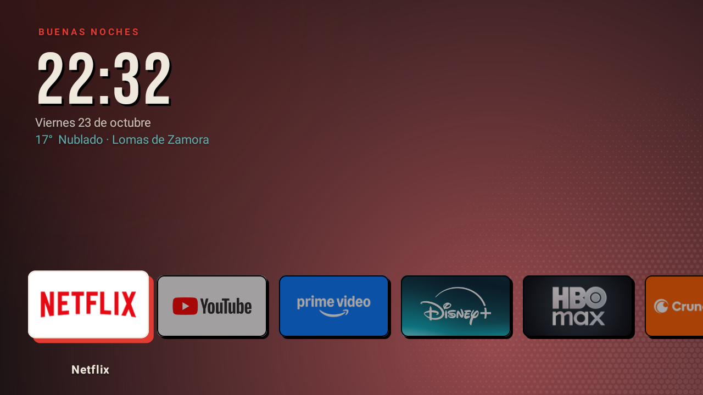
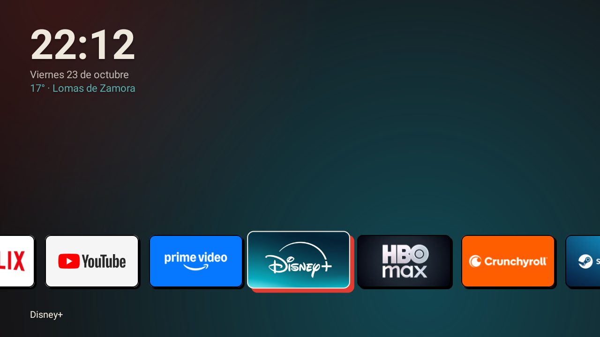
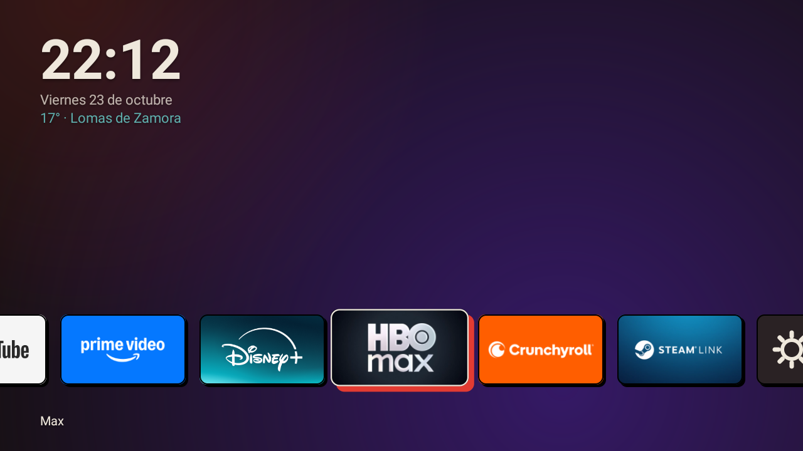
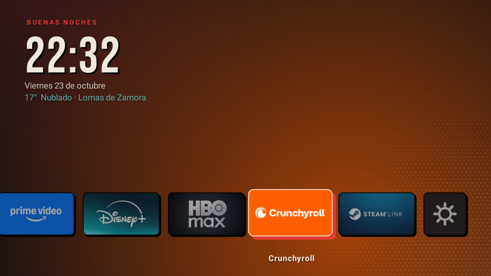
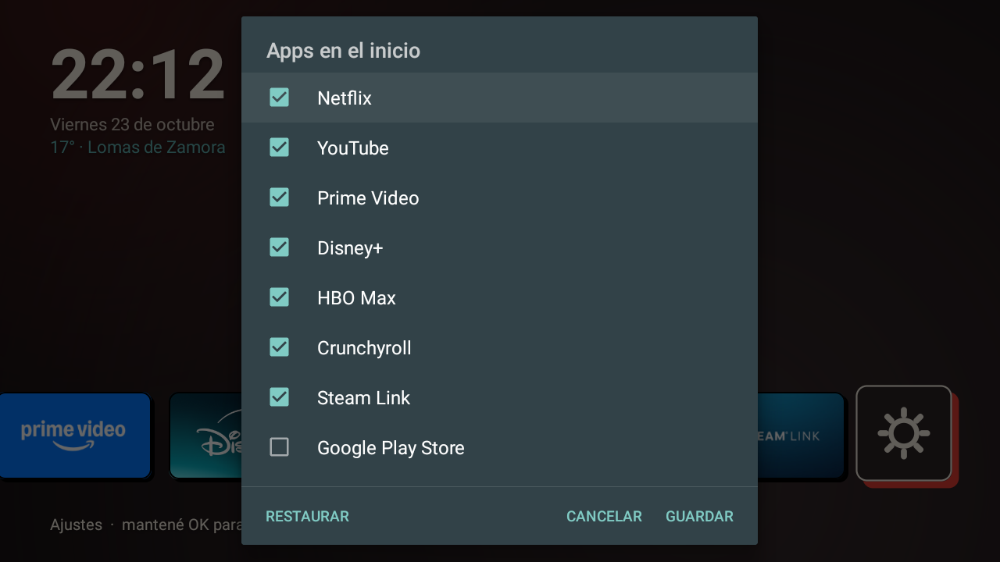
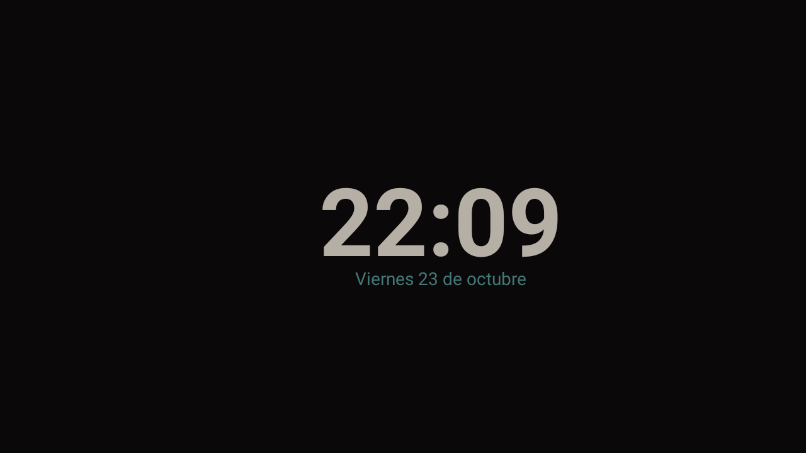

# Quincho

Launcher minimalista para Android TV, hecho a medida para una TV Noblex de 32" con apenas 1 GB de RAM.
Una sola pantalla, sin menús que tapen todo, sin recomendaciones ni publicidad: reloj, clima y una fila
de tarjetas con las apps que se usan de verdad.

> *Quincho*: el lugar techado donde se junta la familia. Un rincón chico y sin vueltas para sentarse
> a ver algo.

Comparte la identidad visual de **Ombú** (el entorno de escritorio hecho en Quickshell): fondo oscuro,
bordes entintados, sombras duras y acento rojo, pero en una versión sobria, pensada para usarse desde el
sillón.



## Qué hace

- **Inicio de una sola fila.** Tarjetas apaisadas con el **banner real de cada app** (Android lo trae
  en el propio paquete; no hay logos copiados en el proyecto).
- **Foco claro desde lejos.** La tarjeta enfocada crece, se levanta y proyecta una sombra roja con borde
  crema. Abajo a la izquierda aparece su nombre.
- **Fondo que cambia de color.** El resplandor del fondo se tiñe con el color dominante del banner
  enfocado, con una transición suave de 600 ms.
- **Reloj, fecha y clima de Lomas de Zamora** (Open-Meteo, sin clave ni cuenta).
- **Apps editables sin recompilar.** Mantené OK sobre el engranaje de Ajustes y elegí qué apps van en
  el inicio.
- **Protector de pantalla propio.** A los 3 minutos de inactividad, el reloj y la fecha derivan muy
  despacio sobre fondo casi negro, para no marcar el panel.
- **Aviso de conexión.** Si se cae internet aparece un "● Sin internet" discreto, y el clima se
  actualiza solo cuando vuelve.
- **Pensado para no romperse.** El botón Atrás no hace nada, Home siempre vuelve al primer ícono y
  el orden de la fila es fijo.

| Disney+ | Max |
| :---: | :---: |
|  |  |

| Crunchyroll | Elegir apps |
| :---: | :---: |
|  |  |

| Protector de pantalla |
| :---: |
|  |

## Números

Medidos en la TV real (Noblex, MediaTek, Android 11, 32 bits, 1 GB de RAM, 720p):

| | |
| --- | --- |
| APK `release` | **~37 KB** |
| RAM en uso (PSS) | **~27 MB** |
| Dependencias | **ninguna** (solo el SDK de Android y Kotlin) |
| Compose / AndroidX | no |

## Decisiones de diseño

- **Views clásicas, no Jetpack Compose.** Con 1 GB de RAM el costo de Compose pesa más que el beneficio
  para una pantalla tan simple. Todo se dibuja con `View`, `Canvas` y `ViewPropertyAnimator`.
- **Cero dependencias.** Nada de AndroidX, Palette, Glide ni Retrofit. El color dominante se calcula con
  un promedio ponderado por saturación sobre una miniatura de 16×9; el clima es un `HttpURLConnection`
  más `org.json`.
- **Resolución independiente.** Todas las medidas están en una unidad `u` = ancho de pantalla / 1280, así
  el diseño se ve igual en 720p, 1080p o 4K.
- **Scroll controlado.** `FilaScroll` anula el desplazamiento automático por foco de Android y centra la
  tarjeta enfocada a mano, para que la fila no "salte".
- **La tarjeta se dibuja a sí misma.** `Tile` pinta la sombra dura, el recorte redondeado, el banner y el
  borde en `onDraw`; no hay XML de layouts.

El diseño salió de un mockup interactivo en HTML que está en [`docs/diseno/mockup.html`](docs/diseno/mockup.html)
(abrilo en el navegador y movete con las flechas; las teclas 1/2/3 cambian de variante).

## Estructura

> El identificador interno de la app sigue siendo `com.ombu.tv` (de cuando se llamaba Ombú TV). Cambiarlo
> haría que Android la trate como otra app y obligaría a reinstalarla y volver a fijarla como inicio.

```
quincho/
├── app/src/main/
│   ├── AndroidManifest.xml         # categorías HOME y LEANBACK_LAUNCHER
│   ├── kotlin/com/ombu/tv/
│   │   ├── MainActivity.kt         # pantalla, fila de apps, clima, red, protector, diálogo de apps
│   │   ├── Tile.kt                 # tarjeta de una app (foco, sombra, banner, borde)
│   │   ├── FondoView.kt            # fondo con resplandor teñido y transición
│   │   └── Reposo.kt               # protector de pantalla
│   └── res/values/styles.xml
├── docs/
│   ├── capturas/                   # capturas reales desde la TV
│   ├── diseno/mockup.html          # mockup interactivo del diseño
│   └── diagnostico-botones-del-control.md
├── scripts/instalar.sh             # compila e instala por adb
└── README.md
```

## Requisitos

- JDK 17
- Android SDK con `platforms;android-34` y `build-tools;34.0.0` (sirven las *command-line tools*, no hace
  falta Android Studio)
- `adb` y una TV con Android TV 8 o superior con **depuración por red** activada

En Arch Linux: `sudo pacman -S jdk17-openjdk gradle` y las *cmdline-tools* del SDK. El proyecto trae su
propio `gradlew`, así que no depende de la versión de Gradle instalada.

```sh
export ANDROID_HOME=$HOME/Android/Sdk
export JAVA_HOME=/usr/lib/jvm/java-17-openjdk
```

## Compilar

```sh
./gradlew assembleDebug     # app/build/outputs/apk/debug/app-debug.apk
./gradlew assembleRelease   # app/build/outputs/apk/release/app-release.apk (minificado con R8)
```

El `release` se firma con la clave de debug del SDK porque es una app de uso personal por *sideload*. Si
alguna vez se publica en una tienda hay que crear una clave propia.

## Instalar en la TV

Con el script, que compila, conecta, instala y abre la app:

```sh
scripts/instalar.sh 192.168.1.37           # solo instala
scripts/instalar.sh 192.168.1.37 --home    # además lo deja como launcher por defecto
```

O a mano:

```sh
adb connect 192.168.1.37:5555
adb install -r app/build/outputs/apk/release/app-release.apk
adb shell cmd package set-home-activity com.ombu.tv/.MainActivity
```

Para volver al launcher anterior, apuntá `set-home-activity` a su componente. Si no queda ninguno, Android
usa el `FallbackHome` del sistema.

> **Ojo:** una actualización del sistema de la TV puede pisar el launcher por defecto. Si pasa, repetí el
> comando de `set-home-activity`.

## Uso

| Acción | Resultado |
| --- | --- |
| ← → | Mover el foco por la fila |
| OK sobre una app | Abrirla |
| Mantener OK sobre Ajustes | Elegir qué apps aparecen en el inicio |
| Home | Volver al primer ícono |
| Atrás | No hace nada (es el inicio) |
| 3 min sin tocar nada | Entra el protector; cualquier tecla lo cierra |

Las apps de fábrica, en orden fijo: Netflix, YouTube, Prime Video, Disney+, Max, Crunchyroll y Steam Link.
Las que se agreguen desde el diálogo van después, ordenadas por nombre. El botón **Restaurar** del diálogo
vuelve a la lista de fábrica.

Para cambiar la lista de fábrica o el nombre y color de respaldo de una app, se edita la lista `entradas`
al principio de [`MainActivity.kt`](app/src/main/kotlin/com/ombu/tv/MainActivity.kt).

## Limitaciones conocidas

- **No muestra "Continuar viendo" ni recomendaciones de las apps.** Leer ese contenido exige el permiso
  `ACCESS_ALL_EPG_DATA`, que es `signature|privileged`: solo lo pueden tener apps de sistema.
- **El clima está fijo en Lomas de Zamora** (coordenadas en `pedirClima()`).
- **El aviso "Sin internet" no se probó** cortando la red de la TV real; el resto de las funciones sí
  se probó en el dispositivo.
- **Una app instalada después no aparece sola.** Hay que agregarla desde el diálogo de apps.

## Problemas conocidos del hardware

Antes de escribir el launcher hubo que arreglar los botones dedicados del control, que no respondían
por un paquete del fabricante desinstalado. La historia completa está en
[`docs/diagnostico-botones-del-control.md`](docs/diagnostico-botones-del-control.md).

## Hecho con

Kotlin 2.0, Android Gradle Plugin 8.7, Gradle 8.9. Desarrollado y probado sobre CachyOS (Arch Linux) con
`adb` por red, con ayuda de Claude Code.
