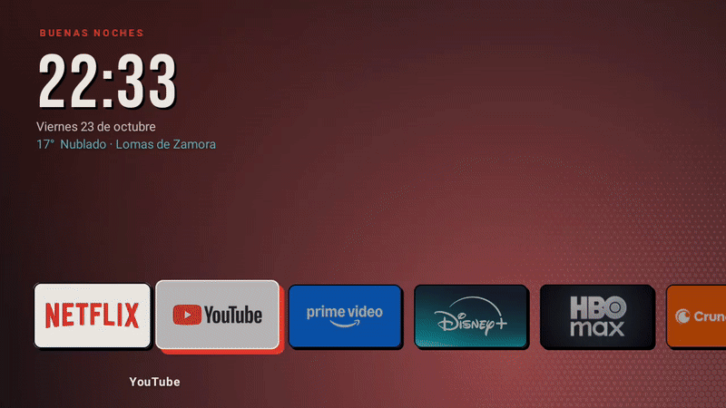

<div align="center">

# Quincho

**Un launcher para Android TV que pesa 67 KB y no te muestra publicidad.**

Reloj, clima y tus apps. Nada más.




</div>

<details>
<summary><b>English</b></summary>

Quincho is a minimalist Android TV home screen built for a low-end TV (1 GB RAM, 720p). One row of
apps using each app's real banner, a big clock, the weather, and a background that takes the color of
the focused app. No ads, no recommendation rows, no dependencies: a ~67 KB APK that uses ~35 MB of RAM.
Built with plain Android Views in Kotlin. The UI is in Spanish.

</details>

---

## Por qué

El inicio de fábrica de Android TV es una vidriera: filas de recomendaciones, publicidad y apps
"sugeridas" que nadie pidió, en una tele de 1 GB de RAM que se arrastra para mostrarlas.

Quincho hace lo contrario. Una pantalla, las apps que usás, y que se entienda desde el sillón sin
anteojos. Lo usa una familia todos los días: si mamá no lo entiende a la primera, está mal diseñado.

> *Quincho*: el lugar techado donde se junta la familia.

## Qué tiene

| | |
| --- | --- |
| **Banners reales** | Cada tarjeta usa el banner oficial que la app trae adentro. No hay logos copiados en el repo. |
| **Foco que se ve de lejos** | La tarjeta enfocada crece con un pequeño rebote, se ilumina y proyecta una sombra roja. Las demás se apagan. |
| **Fondo vivo** | El fondo toma el color dominante del banner enfocado, con una trama de semitonos en la esquina. |
| **Reloj, fecha y clima** | Saludo según la hora y el estado del cielo de [Open-Meteo](https://open-meteo.com/) (sin cuenta ni clave). |
| **Protector de pantalla** | A los 3 minutos sin tocar nada, el reloj deriva despacio sobre negro para no marcar el panel. |
| **Apps a elección** | Mantené OK sobre Ajustes y elegí qué apps aparecen. Sin recompilar. |
| **Aviso de conexión** | Si se cae internet aparece un "● Sin internet" discreto. |
| **A prueba de toques** | Atrás no hace nada, Home vuelve al principio y el orden de la fila es fijo. |

<table>
  <tr>
    <td></td>
    <td></td>
  </tr>
  <tr>
    <td></td>
    <td></td>
  </tr>
  <tr>
    <td></td>
    <td></td>
  </tr>
</table>

## Instalación

Necesitás `adb` y la **depuración por red** activada en la TV (Ajustes → Preferencias del dispositivo →
Acerca de → tocar 7 veces "Compilación" → Opciones de desarrollador).

**1. Bajá el APK** de la [última versión](../../releases/latest).

**2. Instalalo y dejalo como inicio:**

```sh
adb connect IP-DE-TU-TV:5555
adb install quincho.apk
adb shell cmd package set-home-activity com.ombu.tv/.MainActivity
```

Listo. Apretá Home.

<details>
<summary>Volver al launcher de antes</summary>

```sh
# Ver qué launchers hay instalados
adb shell cmd package query-activities -a android.intent.action.MAIN -c android.intent.category.HOME

# Dejar otro como inicio
adb shell cmd package set-home-activity <paquete>/<actividad>

# O desinstalar Quincho: Android vuelve al launcher del sistema
adb uninstall com.ombu.tv
```

Una actualización del sistema de la TV puede pisar el inicio elegido. Si pasa, repetí `set-home-activity`.

</details>

## Uso

| Control | Qué hace |
| --- | --- |
| ← → | Moverse entre apps |
| OK | Abrir la app |
| Mantener OK sobre ⚙ | Elegir qué apps aparecen |
| Home | Volver a la primera app |
| Atrás | Nada (estás en el inicio) |

## Personalizar

Quincho se hizo para una casa en particular, pero cambiarlo es tocar dos lugares de
[`MainActivity.kt`](app/src/main/kotlin/com/ombu/tv/MainActivity.kt):

- **Apps de fábrica y su orden:** la lista `entradas` (paquete, nombre y color de respaldo).
- **Ciudad del clima:** la latitud y longitud en `pedirClima()`. Viene configurado para Lomas de
  Zamora, Buenos Aires.

## Compilar

Requiere JDK 17 y el Android SDK (`platforms;android-34`, `build-tools;34.0.0`). Alcanza con las
*command-line tools*, no hace falta Android Studio.

```sh
export ANDROID_HOME=$HOME/Android/Sdk
./gradlew assembleRelease
# app/build/outputs/apk/release/app-release.apk

# o compilar e instalar en la TV de una:
scripts/instalar.sh IP-DE-TU-TV --home
```

## Cómo está hecho

Pensado para una **Noblex de 32" con chip MediaTek, Android 11, 32 bits, 1 GB de RAM y 720p**: si anda
bien ahí, anda bien en cualquier lado.

- **Views clásicas, sin Jetpack Compose.** Para una pantalla así, Compose cuesta más RAM de lo que
  aporta. Todo se dibuja con `Canvas` y `ViewPropertyAnimator`.
- **Cero dependencias.** Ni AndroidX, ni Palette, ni Glide, ni Retrofit. Eso deja un APK de 67 KB
  (la mayor parte es la tipografía).
- **Color dominante casero.** Promedio ponderado por saturación sobre una miniatura de 16×9 del banner.
- **Trama de semitonos sin costo.** Se dibuja una sola vez en un bitmap `ALPHA_8` (1 byte por píxel) y
  en cada cuadro solo se pinta con el color del momento.
- **Resolución independiente.** Todas las medidas usan `u = ancho / 1280`: se ve igual en 720p, 1080p
  o 4K.

```
app/src/main/kotlin/com/ombu/tv/
├── MainActivity.kt   # pantalla, fila, clima, red, protector y diálogo de apps
├── Tile.kt           # una tarjeta: foco, velo, sombra dura, banner y borde
├── FondoView.kt      # fondo teñido y trama de semitonos
└── Reposo.kt         # protector de pantalla
```

El diseño salió de un [mockup interactivo](docs/diseno/mockup.html) en HTML (abrilo y movete con las
flechas). Y antes de escribir una línea hubo que [arreglar los botones del control de la
TV](docs/diagnostico-botones-del-control.md), que no andaban por un paquete del fabricante desinstalado.

## Limitaciones

- **No muestra "Continuar viendo" ni recomendaciones.** Leer ese contenido de otras apps requiere el
  permiso `ACCESS_ALL_EPG_DATA`, reservado a apps del sistema. Sin root, no hay forma.
- **La ciudad del clima y la lista de fábrica se cambian en el código** (ver [Personalizar](#personalizar)).
- **La interfaz está en español.**

## Ideas para más adelante

- [ ] Elegir la ciudad del clima desde el diálogo de ajustes
- [ ] Varios temas de color
- [ ] Traducción al inglés

## Créditos

- Tipografía [Bebas Neue](https://github.com/dharmatype/Bebas-Neue) de Dharma Type, bajo
  [SIL Open Font License 1.1](LICENCIAS/BebasNeue-OFL.txt).
- Clima de [Open-Meteo](https://open-meteo.com/).
- Identidad visual heredada de **Ombú**, mi entorno de escritorio en Quickshell.
- Hecho en CachyOS con `adb` por WiFi y [Claude Code](https://claude.com/claude-code).

## Licencia

El código está bajo licencia [MIT](LICENSE): usalo, modificalo y compartilo libremente. La tipografía
Bebas Neue mantiene su propia licencia [OFL](LICENCIAS/BebasNeue-OFL.txt). Los banners de las apps no
están en este repo: Quincho los lee de cada app instalada.
